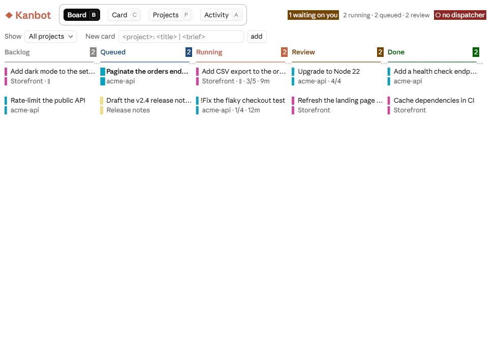
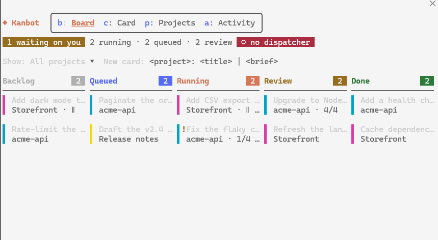

# Kanbot

A global kanban board inside Claude Code that hands queued cards to background Claude agents across your projects. It runs in the Code tab of the Claude desktop app and in the terminal.

- **Projects** come in three types:
  - **Repo**: one git repo. Cards get their own branch and worktree, and are merged when you mark them Done.
  - **Workspace**: a parent folder holding several repos (for example `C:\development\ideajudge-2026` with `ideajudge-ui`, `ideajudge-services`, ... inside). Kanbot finds the repos and each one's base branch; a card can change any of them.
  - **Chat**: a plain folder. Cards run one at a time, no git.
- **Cards** move Backlog → Queued → Running → Review → Done. You move cards into Queued and Done; Kanbot moves the rest.
- **One dispatcher session** starts queued cards as background agents in each card's folder, tracks their progress, and runs the merge when you mark a card Done.

## Screenshots

The Board, Card, Projects and Activity tabs, with sample data.

**Code tab of the desktop app**



**Terminal**



## Requirements

- Claude Code 2.1.287 or later (mods are on by default from that version). Check with `claude --version`.
- Mods allowed on the machine. On a managed work machine, run `/plugin` in a session first: if your organization only allows managed mods, user-installed mods like this one will not load.

## Install

From GitHub:

```bash
claude plugin marketplace add roboza/kanbot
claude plugin install kanbot@kanbot
```

Or from a local copy: unzip or clone this folder somewhere you keep it, for example `~/claude-mods/kanbot`. Then, in a terminal:

```bash
claude plugin marketplace add ~/claude-mods/kanbot
claude plugin install kanbot@kanbot
```

Kanbot is then active in new sessions, including the Code tab of the desktop app. Because the marketplace is a local folder, edits to the folder take effect after `/reload-plugins`.

To try it without installing, start the terminal with `claude --plugin-dir ~/claude-mods/kanbot`.

## Getting started

1. **Open the board.** In any Code-tab session, run `/kanbot`. The board opens in a side pane.
2. **Add your projects.** Open the Projects tab (`p`). For each project, enter a name, pick Repo, Workspace or Chat, give the absolute folder, and for repos the base branch, how many cards may run at once, and an optional test command to run after merging. Kanbot checks the folder and branch before saving. For a workspace it lists the repos it found and their base branches; save again later to pick up new repos.
3. **Start a dispatcher.** Open a Code-tab session in a folder that contains all your projects and the `.kanbot-worktrees` folder beside them (for example `C:\development` or `~/work`), set its permission mode to one that allows edits (accept edits, or auto), and run `/kanbot work`. Keep this session open: it runs the agents. Agents inherit its permission mode; a tool they are refused flags the card as waiting on you.
4. **Add cards.** Type in the New card field (`<title> | <brief>`, or `<project>: <title> | <brief>` when showing all projects), or run `/kanbot add`. Click a card to open it: edit the brief, add acceptance checks, and choose sequential or parallel.
5. **Queue work.** Drag cards from Backlog to Queued, ordered top to bottom. Kanbot starts them as room allows.
6. **Review.** When a card reaches Review, open it to read Claude's summary. Then drag it to Done (or press Done) to merge it, send it back with a note, or discard the work.

## From a plan to cards

Plan the work in any Code-tab or terminal session. When you have agreed a plan, run `/kanbot queue`. Claude splits the plan into cards and adds them to Backlog through Kanbot's `queue_cards` tool. Each card gets a self-contained brief (the agent that runs it can't see the conversation), acceptance checks, sequential or parallel, and, for a workspace, the repos it changes.

- The project is the one whose folder holds the session's folder. Name another one first: `/kanbot queue IdeaJudge`.
- Anything after the project is passed on as guidance: `/kanbot queue IdeaJudge keep it to three cards`.
- Cards wait in Backlog. Review and edit them on the board, then move them to Queued to run them.
- You can also just ask Claude to "put this plan on Kanbot", which uses the same tool.

## How cards run

- Each project's queue drains top to bottom. A **sequential** card waits until nothing else of its project runs and holds the cards under it. A **parallel** card starts while the project's limit allows. Chat projects always run one card at a time.
- All projects run side by side, up to a global limit (4 by default; change it in the Projects tab).
- A repo card runs in its own git worktree on branch `kanbot/<card id>`, at `<parent of repo>/.kanbot-worktrees/<repo>/<card id>`. Your main checkout is not touched while it works.
- A **workspace** card gets a card folder that mirrors the workspace, at `<parent of workspace>/.kanbot-worktrees/<workspace>/<card id>/<repo>`, with one worktree per repo on branch `kanbot/<card id>`. By default a card may change every repo; open the card to tick only the repos it should touch.
- **Done** on a workspace card merges only the repos where the card has commits, each into its own base branch. The merge agent checks every repo is clean and on its base before merging anything, and stops at the first conflict it cannot resolve. Repos that merged are cleaned up; the card stays in Review listing the repos still to merge, and marking it Done again retries those.
- **Done** on a repo card starts a merge agent in the repo's main folder. It stops if the checkout has uncommitted changes or is not on the base branch, merges with `--no-ff`, runs the test command if you set one, and undoes the merge if the tests fail. Kanbot then checks the branch really landed before moving the card to Done and removing the worktree and branch. Nothing is pushed.
- If an agent disappears (for example, the dispatcher session was closed), the card returns to the top of Queued and starts again.

## Commands

| Command | Does |
| --- | --- |
| `/kanbot` | Open the board |
| `/kanbot add <title>` | Add a card; also `<project>: <title> \| <brief>` |
| `/kanbot queue [project] [notes]` | Have Claude turn the plan agreed in this conversation into cards in Backlog |
| `/kanbot work` | Make this session the dispatcher (`work force` takes over from another) |
| `/kanbot pause` / `resume` | Stop or restart starting new cards |
| `/kanbot stop` | Stop dispatching from this session |
| `/kanbot projects` | Open the Projects tab |

Pane keys: `b` Board, `c` Card, `p` Projects, `a` Activity.

## Where data lives

Everything is in Kanbot's own store under `~/.claude/plugins/store/`, shared by every session on the machine. The status line in each session shows running, queued, waiting and review counts.

## Development

```bash
claude plugin validate .
claude plugin test .
```
